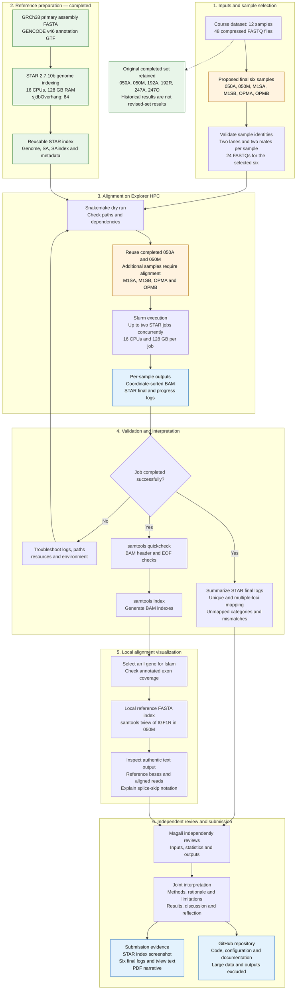

# Human RNA-seq alignment with STAR and Snakemake

A reproducible workflow developed for Northeastern University Project 5
and executed on Explorer HPC on October 14, 2026.

## Project objective

Align six human paired-end RNA-seq samples to the GRCh38 primary assembly
using STAR and GENCODE v46 annotation, inspect alignment statistics,
and prepare indexed BAM files for local alignment visualization.

This project evaluates alignment outcomes. It does not perform
gene quantification or differential expression analysis.

## Project 5 workflow

The original six-sample analysis is complete. Following Magali’s review,
the proposed final sample set is 050A, 050M, M1SA, M1SB, OPMA, and OPMB.
The four additional alignments must be verified before updating the
final results.

### Interpretation boundaries

- High overall mapping does not necessarily mean unique genomic assignment.
- BAM quickcheck is a rapid structural check, not exhaustive validation.
- The IGF1R view supports local alignment inspection, not differential expression.
- Revised sample labels and comparisons must be checked against course metadata.
- Update completion labels only after the additional outputs are verified.
## Contributors

- Md Tariqul Islam: group leader; HPC setup, workflow implementation,
  execution, BAM checks and indexing, and candidate alignment visualization.
- Megali Eisik: project design; independent result analysis and joint
  discussion are planned and will be documented after completion.

## Completed analysis

- Six distinct samples comprising 24 gzipped FASTQ files.
- Both sequencing lanes and both mates included for every sample.
- 104,121,415 input read pairs.
- STAR genome index generated successfully.
- Six coordinate-sorted BAM files generated successfully.
- All six BAMs passed samtools quickcheck and were indexed.
- IGF1R exon inspected in sample 050M using samtools tview.

## Software

| Component | Version |
|---|---|
| Python | 3.13.5 |
| Snakemake | 9.27.0 |
| STAR | 2.7.10b |
| samtools | 1.21 |
| HTSlib | 1.21 |

Python package versions are recorded in
config/python-packages.lock.txt.

## Repository contents

- Snakefile: genome indexing, sample alignment, and BAM indexing rules.
- config/config.yaml: reference paths and workflow settings.
- config/samples.tsv: six selected sample identifiers.
- config/python-packages.lock.txt: recorded Python dependencies.
- scripts/submit_index.sh: Slurm coordinator for genome indexing.
- scripts/submit_alignments.sh: Slurm coordinator for six alignments.
- scripts/star_index.sh: additional indexing script; review before use.

## Reference data

The executed analysis used the course-provided files:

- GRCh38.primary_assembly.genome.fa
- gencode.v46.annotation.gtf

References and sequencing data are external inputs and are not included
in this repository. Configuration and submission scripts currently
contain Explorer-specific paths and account settings.

## Execution on Explorer

Run from the project directory. Load Python and activate the prepared
Snakemake environment first.

    module load python/3.13.5
    source /scratch/islam.mdtar/project05-snakemake-env/bin/activate

Validate planned indexing before submitting it:

    snakemake --dry-run --printshellcmds --cores 16 star_index
    sbatch scripts/submit_index.sh

After successful index completion, validate and submit alignments:

    snakemake --dry-run --printshellcmds --cores 32 align_all
    sbatch scripts/submit_alignments.sh

After alignments finish, load samtools and index BAMs inside an
appropriate compute allocation:

    module load samtools/1.21
    snakemake --dry-run --cores 2 index_all
    snakemake --cores 2 --resources mem_mb=8000 index_all

The STAR child jobs request 16 CPUs, 128 GB RAM, and eight hours each.
The alignment coordinator permits two concurrent STAR jobs.

Do not execute STAR locally in a small setup allocation.
Do not launch simultaneous Snakemake coordinators in this directory.

The current default target covers the genome index only.
Use the explicit targets shown above for alignment and BAM indexing.
Reference FASTA indexing, exon screening, tview, and report preparation
were separate steps and are not yet automated in the Snakefile.

## Alignment results

| Sample | Input pairs | Unique mapping | Multiple loci |
|---|---:|---:|---:|
| 050A | 16,402,376 | 63.61% | 33.47% |
| 050M | 16,583,598 | 69.99% | 26.41% |
| 192A | 20,436,136 | 50.29% | 46.92% |
| 192R | 17,024,733 | 49.11% | 48.10% |
| 247A | 17,122,102 | 58.27% | 39.06% |
| 247O | 16,552,470 | 70.52% | 26.40% |

Combined unique and accepted multimapping ranged from 96.40% to 97.33%.
High overall mapping did not imply unique genomic assignment.
The causes of between-sample multimapping differences were not established.

## Validation and limitations

The first FASTQ record in each inspected file contained an 85-base read.
This was not an exhaustive FASTQ integrity or read-length assessment.

BAM quickcheck examines basic file structure rather than every alignment.
Successful indexing supports regional access but does not prove
biological correctness.

Alignment filters retained STAR 2.7.10b defaults unless explicitly set.
No parameter-sensitivity analysis was performed.

Biological conditions and replicate relationships were not verified.
The comparison is descriptive and does not support treatment effects.

## Data and provenance

Large data, generated alignments, indexes, logs, and submission evidence
are excluded by .gitignore. Preserve original HPC evidence separately.

This repository documents the workflow implementation. A fresh
end-to-end execution from this Git snapshot has not yet been performed.

## References

Dobin, A., et al. (2013). STAR: Ultrafast universal RNA-seq aligner.
Bioinformatics, 29(1), 15–21.
https://doi.org/10.1093/bioinformatics/bts635

Mölder, F., et al. (2021). Sustainable data analysis with Snakemake.
F1000Research, 10, 33.
https://doi.org/10.12688/f1000research.29032.2

Danecek, P., et al. (2021). Twelve years of SAMtools and BCFtools.
GigaScience, 10(2), giab008.
https://doi.org/10.1093/gigascience/giab008
